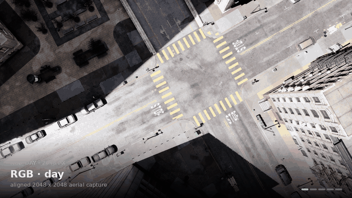
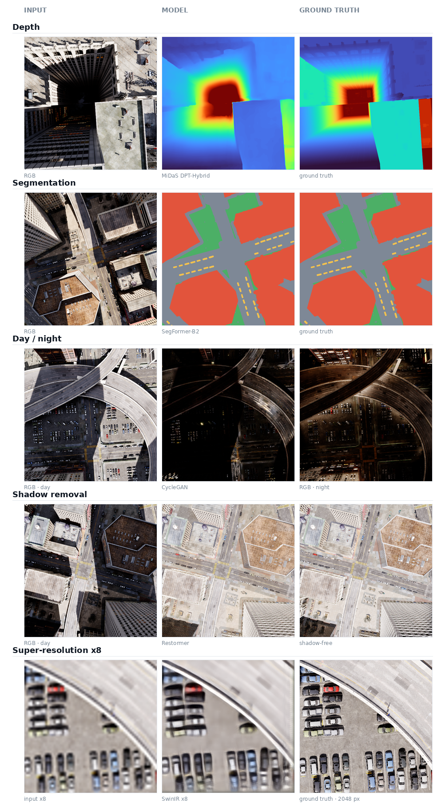
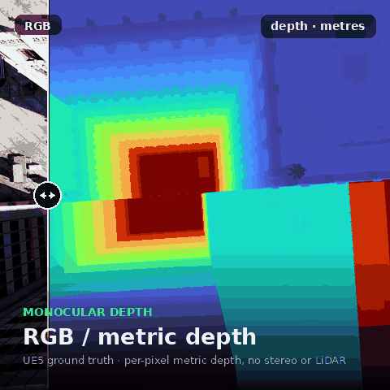
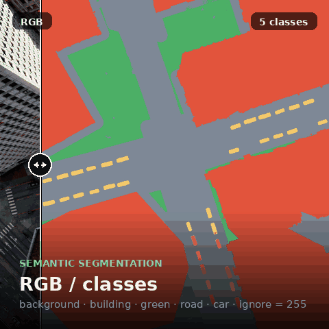
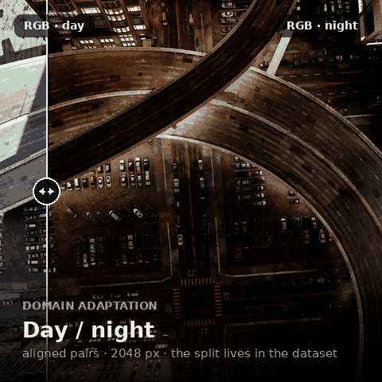
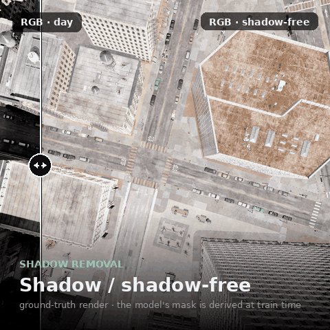
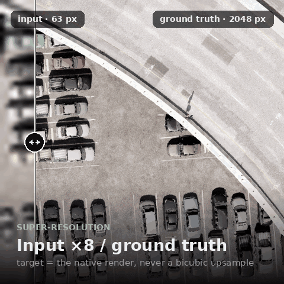
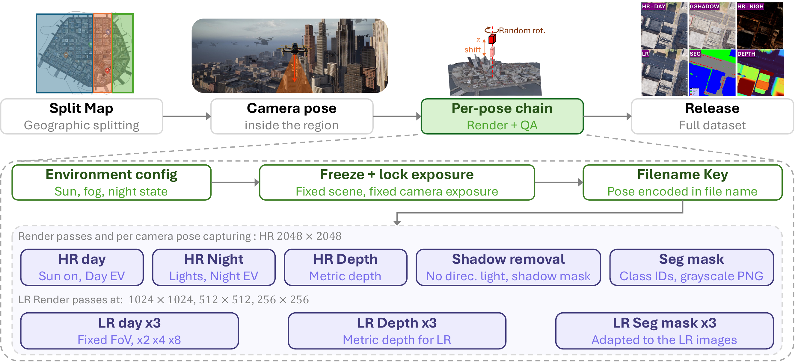

# SyMTRS

**Five aerial benchmarks from one Unreal Engine 5 capture.** SyMTRS renders the same urban
scene five ways — RGB by day and by night, with cast shadows and without, metric depth in
metres, and a five-class semantic mask — perfectly registered at 2048 × 2048 and split into
`train/`, `val/` and `test/` scenes. This repository is the benchmark that trains and scores
the five tasks on that data, from one command or one Python call.

[](https://arxiv.org/abs/2604.21801)
[](https://huggingface.co/datasets/safouaneelg/SyMTRS)
[](LICENSE)



The scenes are rendered with [MatrixCity](https://arxiv.org/abs/2309.16553) on Unreal
Engine 5, which is what gives the depth, the masks and the night/shadow-free pairs their
pixel-perfect registration:

[matrixcity.webm](https://github.com/user-attachments/assets/bd63b74d-fca5-452b-8f19-554341188614)

---
Reproducibility guide for the `SyMTRS` workspace. The dataset is 20,000 frames
(14,000 train / 3,000 val / 3,000 test) and 767 GB; every command in this guide also runs
against `symtrs make-dummy`, so an install can be checked without it.

You first need the dataset from our huggingface repo
`https://huggingface.co/datasets/safouaneelg/SyMTRS`. The release is organised by task, so
you can pull only the groups your work needs instead of the whole 767 GB:

```sh
pip install -e '.[launcher]'     # textual + huggingface_hub; [hub] is enough for flags only
symtrs                           # interactive: pick tasks, splits and models, review the size
```

or the same selection without a terminal:

```sh
symtrs get --list
symtrs get --preset depth-2048 --data-root /data/SyMTRS --yes
symtrs get --task segmentation --resolutions 2048 --splits train,val --yes
symtrs get --models midas_dpt_hybrid@1024 --models-dir runs/ --yes
symtrs get --verify --data-root /data/SyMTRS
```

The release is split across several Hugging Face projects — metadata, the image store, one
project per task vertical and one per model vertical — and the launcher copies the files you
select at the paths the release publishes, without reshaping the dataset. `docs/hub.md`
documents the repository map and the manifest. While the split release is still rolling out,
`git clone` remains the fallback:

```sh
git clone https://huggingface.co/datasets/safouaneelg/SyMTRS
```

## Five tasks, one capture

Every frame exists in five registered versions — same camera position, same geometry, same
2048 × 2048 grid — so a task is a choice of folders rather than a separate dataset:

| Task | Input | Target | Models | Metric |
| --- | --- | --- | --- | --- |
| Monocular depth | `rgb_day` | `depth` — metric, metres | MiDaS ×5, Depth Anything 3 ×2 | RMSE ↓ |
| Semantic segmentation | `rgb_day` | `semantic` — 5 classes | U-Net, DeepLabV3 ×2, SegFormer ×3 | mIoU ↑ |
| Domain adaptation | `rgb_day` | `rgb_night` | CycleGAN, pix2pix (day⇄night, shadow⇄shadow-free) | FID ↓ |
| Shadow removal | `rgb_day` | `rgb_noshadow` | ShadowFormer, Restormer, Uformer, ShadowMaskFormer | PSNR ↑ |
| Super-resolution | `rgb_day_lr/xN` | `rgb_day` | SRCNN, autoencoder, SRGAN, SwinIR | PSNR ↑ |

One `test/` scene per task: the input, a benchmark model's prediction, and the ground
truth. Every panel on this page is generated by
[`scripts/make_media.py`](scripts/make_media.py) from the dataset and the campaign
checkpoints — the scene stems and exact checkpoints are recorded in
[`docs/assets/media/media.json`](docs/assets/media/media.json).



<table>
  <tr>
    <td width="50%"><br>
      <sub><b>Depth</b> — per-pixel metric depth from UE5, no stereo and no LiDAR. The model
      predicts disparity; it is aligned to metres with the MiDaS protocol before scoring.</sub></td>
    <td width="50%"><br>
      <sub><b>Semantic segmentation</b> — background, building, green, road, car. Pixels off
      the class grid decode to <code>ignore_index=255</code> and are excluded from the loss
      and the confusion matrix.</sub></td>
  </tr>
  <tr>
    <td width="50%"><br>
      <sub><b>Day ⇄ night</b> — the same camera and geometry under a different illumination.
      Unpaired (CycleGAN) and paired (pix2pix) translation, scored by FID/KID against real
      night imagery.</sub></td>
    <td width="50%"><br>
      <sub><b>Shadow removal</b> — SyMTRS ships the shadow-free render as ground truth and
      derives the shadow mask at train time; the four models are scored on shadow and
      non-shadow pixels separately.</sub></td>
  </tr>
  <tr>
    <td width="50%"><br>
      <sub><b>Super-resolution ×8</b> — the 63 px input against the native 2048 px render.
      The target is always the high-resolution image, never a bicubic upsample; the SwinIR
      ×8 prediction is the middle column of the grid above. The LR level is its own render
      pass at a coarser sampling, not a blur of the 2048 frame.</sub></td>
    <td width="50%"><br>
      <sub><b>One capture, five modalities</b> — RGB day → night → shadow-free → metric depth
      → semantics, with the geometry held fixed throughout.</sub></td>
  </tr>
</table>

### How the five modalities are rendered



Each camera pose is rendered in one pass with the environment frozen, so the five outputs
share an exposure, a geometry and a filename. The low-resolution levels are re-rendered at
×2/×4/×8 rather than obtained by downsampling the 2048 frame, which is what makes the
super-resolution pairs real pairs.

## What is in this repository

- `symtrs/` — the benchmark package: multi-resolution **monocular depth**, **semantic
  segmentation**, **day/night and shadow domain adaptation**, **shadow removal** and
  **super-resolution**, driven by one `symtrs` command and usable as a Python library.
- `configs/` — YAML run configurations: one file per model and resolution (80 of them),
  plus `generate_grid.py`, the table they are generated from. See
  [`configs/README.md`](configs/README.md).
- `symtrs/legacy/` — the pre-existing super-resolution implementation and its datasets,
  moved inside the package and now driven through `symtrs` as well (the later edits are listed
  in `symtrs/legacy/README.md`). See
  [Super-resolution](#super-resolution).
- `train_superresolution.py`, `dataloader/` — thin shims that re-export from
  `symtrs/legacy/`, kept so the documented command and imports keep working.
- `pytorch-CycleGAN-and-pix2pix/` — the upstream code used by the domain adaptation task,
  vendored in full at a pinned revision. See [Domain adaptation](#domain-adaptation).
- `third_party/` — the four shadow-removal upstreams (ShadowFormer, Restormer, Uformer,
  ShadowMaskFormer) as git submodules, unmodified and pinned to one commit each; only their
  network classes are used. Notes and licences in `third_party/PINS.md`.
- `scripts/` — the utilities behind the campaign and the figures; `scripts/make_media.py`
  regenerates every image on this page from a dataset root and the run checkpoints.
- `docs/` — the project page (`docs/index.html`) and the media it and this README share.
- `AGENTS.md` — how to set up, run and extend the project, written for an automated
  coder as much as for a person.

## Install

```bash
python -m venv .venv
source .venv/bin/activate
pip install --upgrade pip
pip install -e .
```

The core install covers depth with MiDaS, segmentation with U-Net and
torchvision DeepLabV3, and the CLI. Everything else is an extra:

| Extra | Installs | Needed for |
| --- | --- | --- |
| `exr` | `OpenEXR` | reading the 2048px `.exr` depth maps |
| `cv2` | `opencv-python-headless` | the other EXR backend, and fast image IO |
| `timm` | `timm` | **MiDaS** — see below |
| `da3` | `transformers` | Depth Anything 3 |
| `adapt` | `dominate`, `wandb` | **domain adaptation** — upstream imports both at start-up |
| `shadow` | `scipy`, `einops`, `natsort`, `scikit-image`, `h5py` | **shadow removal** — the upstream network files import them |
| `dev` | `pytest` | the test suite |

```bash
pip install -e '.[exr,timm,da3]'
```

`.npy` depth needs no extra; `.exr` needs one of `exr` or `cv2`.

The `adapt` extra is what an upstream run cannot begin without: the vendored
`train.py` and `test.py` both import `util/visualizer.py`, which imports `dominate` and
`wandb` at module level, before a single option is parsed. They are listed by
`symtrs doctor`, and a domain-adaptation run started without them stops with the install
command rather than upstream's traceback.

### Shadow removal needs the submodules

The shadow-removal networks come from four upstream repositories under `third_party/`,
included as git submodules. A plain `git clone` leaves those folders empty; fetch them with

```bash
git clone --recursive <this repository>              # at clone time, or afterwards:
git submodule update --init third_party
python scripts/fetch_third_party.py --check          # all four should print [ok]
```

Nothing else needs them: depth, segmentation, super-resolution, domain adaptation and the
test suite run without. Install the `shadow` extra in the environment that runs shadow
removal, keeping `numpy==1.26.4` in the same command (`pip install -e '.[shadow]'
numpy==1.26.4`), because `scipy` otherwise pulls numpy 2 and breaks the Depth Anything 3
adapter.

### timm is needed by more than SegFormer

It is worth reading before a model grid starts downloading weights. The MiDaS
checkpoints are loaded through `torch.hub`, and that repository's `hubconf.py`
reaches `import timm` via `midas.blocks` → `backbones.beit`. The upstream `hubconf.py`
declares only `dependencies = ["torch"]`, so nothing warns you — the load simply fails.
`symtrs doctor` reports it correctly, which is why the registry entries list `timm`.

Second, and more awkward: **MiDaS Swin-V2 and BEiT-Large need their own environment.**

- `midas_dpt_swin2_tiny`: on timm 1.0.30 its state_dict reports
  `pretrained.model.layers.3.downsample.reduction.weight` missing; on 0.6.12 it loads.
- `midas_dpt_beit_large`: MiDaS patches timm's BEiT `Block.forward` with a copy that calls
  `self.drop_path`, which timm >= 0.9 split into `drop_path1` / `drop_path2`, so the forward
  raises `AttributeError: 'Block' object has no attribute 'drop_path'`. The adapter refuses
  at build time and names `.venv-zoe` (the environment's name is left from ZoeDepth, which
  was dropped from the benchmark).
- SegFormer is *not* part of this: timm has never shipped MiT, so the encoder comes from
  `transformers` (`pip install -e '.[segformer]'`) and works on any timm.

The other MiDaS models work on both. `symtrs doctor` prints a warning naming whichever side
of this you are currently on. Practically: one environment for MiDaS Swin-V2 + BEiT-Large
(timm 0.6.12, Python 3.10), a second for everything else.

## Dataset layout

```text
/path/to/SyMTRS/
├── train/
│   ├── rgb_day/          2048×2048 PNG
│   ├── rgb_night/        2048×2048 PNG
│   ├── rgb_day_lr/
│   │   ├── x2/           1024×1024 PNG
│   │   ├── x4/            512×512 PNG
│   │   └── x8/            256×256 PNG
│   ├── depth/            2048×2048 EXR, single channel, metric depth in metres
│   ├── depth_lr/x2|x4|x8
│   ├── semantic/         2048×2048 PNG, graylevel class ids
│   └── semantic_lr/x2|x4|x8
├── val/                  same structure
└── test/                 same structure
```

`train/`, `val/` and `test/` each carry the identical structure, and the split is part of
the dataset rather than something the code carves out — so a run cannot silently train on
its own validation scenes.

`rgb_night` has no `_lr` copy: the downsampled folders exist only for the day imagery,
which is what makes domain adaptation a native-resolution (2048) task.

Files are matched across folders by **filename stem** — `rgb_day/RS.100200.png` pairs with
`depth/RS.100200.exr` and `semantic/RS.100200.png`. A stem missing from any folder the
task needs is reported by name, not skipped silently.

### Resolution is a task axis, not super-resolution

This is the one thing to get right about the benchmark. `--resolution` selects **which
folders a run reads**, and both the input and the ground truth come from the same level:

| `--resolution` | Folder suffix | Actual pixel size |
| --- | --- | --- |
| `2048` | *(none)* | 2048 |
| `1024` | `_lr/x2` | 1024 |
| `512` | `_lr/x4` | 512 |
| `256` | `_lr/x8` | 256 |

So `--resolution 1024` trains a MiDaS at 1024px and scores it against the 1024px depth
map. Nothing upsamples anything, and there is no high-resolution target involved. The task
is **multi-resolution depth estimation** — the benchmark's question is how each model
degrades as the ground sampling distance coarsens.

A run that took 1024px input and scored **against the 2048px depth map** would be a
super-resolution task. That is a separate task, with its own models and its own folder of
configs ([Super-resolution](#super-resolution)): there, and only there, the input comes from
`_lr/xN` and the target is native. The distinction is worth holding on to, because the two
tasks read the same folders and would otherwise be easy to confuse:

| Task | input read | target scored against |
| --- | --- | --- |
| depth / segmentation at `resolution: 1024` | `rgb_day_lr/x2` | `depth_lr/x2` (also 1024) |
| super-resolution at `resolution: 1024` | `rgb_day_lr/x2` | `rgb_day` (2048) |

If a folder for the requested resolution is absent, it is an error rather than a fallback
to a coarser level, because a silent fallback would change what the reported number means.

The loaders also support a view-organized dataset tree:

```text
/path/to/SyMTRS/
├── views/
│   ├── train/loc<NNN>/<rgb, depth and seg files for each view>
│   ├── val/loc<NNN>/...
│   └── test/loc<NNN>/...
├── tasks/
└── metadata/
```

Pass the dataset root itself to `--data-root`; the loaders select the requested modality
and resolution by filename. For example:

```bash
symtrs doctor --data-root /path/to/SyMTRS
symtrs train --task segmentation --model unet_small --resolution 256 \
  --data-root /path/to/SyMTRS
```

## Quickstart

The whole pipeline runs offline against a synthetic dataset, which is the fastest way to
check an install:

```bash
symtrs make-dummy --out /tmp/symtrs_dummy --size 256 --train 4 --val 2 --test 2

symtrs doctor --data-root /tmp/symtrs_dummy

symtrs train --task segmentation --model unet_small --resolution 256 \
  --data-root /tmp/symtrs_dummy --epochs 1 --batch-size 2 \
  --limit-train-batches 2 --device cpu --out-dir /tmp/symtrs_run
```

`make-dummy` writes the real layout at a small size, so `doctor` and `train` exercise the
same code paths the real dataset will.

## Tasks and models

`symtrs models` prints this list with descriptions and aliases.

### Depth (multi-resolution)

Each model declares a **protocol**, which decides the loss and what "alignment" means:

- `metric` — the network predicts metres. Scored with `berhu`, alignment `none`.
- `relative` — the network predicts something known only up to an affine map. MiDaS emits
  disparity `s/z + t`: scored with a per-image scale-and-shift fit in disparity space against
  `1/ground truth` (`scale_shift_disparity`), trained with `ssi`. Depth Anything 3 relative
  emits depth up to a scale: `scale` alignment, `silog`. See AGENTS.md rule 3.

| Key | Protocol | Align | Notes |
| --- | --- | --- | --- |
| `midas_small` | relative | scale_shift_disparity | 256px, the cheapest baseline |
| `midas_dpt_hybrid` | relative | scale_shift_disparity | 384px, the standard published baseline |
| `midas_dpt_large` | relative | scale_shift_disparity | 384px |
| `midas_dpt_swin2_tiny` | relative | scale_shift_disparity | 256px |
| `midas_dpt_beit_large` | relative | scale_shift_disparity | 384px, largest MiDaS variant |
| `da3_large` | relative | scale | Depth Anything 3 Large |
| `da3_metric_large` | metric | none | Depth Anything 3, metric head; needs `data.camera_hfov_deg` (60 deg, confirmed by the dataset owner) |

Depth metrics: `rmse`, `mae`, `abs_rel`, `sq_rel`, `d1`, `d2`, `d3`, `silog`.

### Segmentation

**The dataset has 5 classes** (background, building, green, road, car; stored as
`class_id * 63` gray, `data.label_step`), and any pixel labelled `255` is the ignore index — excluded
from both the loss and the confusion matrix. Both the class count and the ignore index are
recorded in the checkpoint, so a model cannot later be scored against a differently
labelled mask set by accident.

| Key | Decoder | Backbone |
| --- | --- | --- |
| `unet_small` | from-scratch U-Net | — |
| `deeplabv3_r50` | torchvision DeepLabV3 | ResNet-50, COCO+VOC pretrained |
| `deeplabv3_r101` | torchvision DeepLabV3 | ResNet-101 |
| `segformer_b0` / `b1` / `b2` | SegFormer head | MiT encoder from timm (ImageNet) |

Segmentation metrics: `miou` (which selects `best.pt`), `pixel_acc`, `mean_acc`,
`mean_dice`, `fwiou`, plus per-class `iou_<k>` / `dice_<k>`.

**DeepLabV3 needs `--batch-size` of at least 2 when training.** torchvision's ASPP pools
globally and then runs a `BatchNorm`, so that `BatchNorm` is always handed a 1×1 feature map
and has only the batch axis to compute its statistics from. One image is not a valid training
batch for it — `--grad-accum` does not help (it repeats forwards rather than widening one) and
neither does `--freeze` (the pooling and its `BatchNorm` are in the head). Evaluation at batch
1 is fine, since `BatchNorm` uses its running statistics in eval mode. U-Net and SegFormer
have no such restriction. `symtrs` checks this and reports it as a one-line error rather than
letting torch's own message through.

### Domain adaptation

`cyclegan` (unpaired) and `pix2pix` (paired by filename), day↔night.

## Command line

```bash
symtrs <command> [options]
```

| Command | What it does |
| --- | --- |
| `train` | train one model at one resolution |
| `eval` | score a checkpoint on a split |
| `infer` | run a model over an image or a directory |
| `inspect` | print a checkpoint's metadata |
| `sweep` | write (and optionally run) the whole model × resolution grid |
| `tables` | collect metrics from run directories into a table |
| `doctor` | check the environment, the dataset layout, and whether a model builds |
| `make-dummy` | generate a small synthetic dataset in the real layout |
| `models` | list the registry |
| `setup-adapt` | verify the vendored CycleGAN/pix2pix tree, or diff it against upstream |

### Training

```bash
# depth, all four resolutions
symtrs train --task depth --model midas_dpt_hybrid --resolution 2048 --data-root /data/SyMTRS
symtrs train --task depth --model midas_dpt_hybrid --resolution 1024 --data-root /data/SyMTRS

# segmentation, 5 classes
symtrs train --task segmentation --model segformer_b2 --resolution 2048 --data-root /data/SyMTRS

# super-resolution: --resolution names the input scale, the factor is derived (2048 -> x1)
symtrs train --task superresolution --model srcnn --resolution 512 --data-root /data/SyMTRS

# zero-shot: evaluate a pretrained model with no training at all
symtrs eval --model midas_dpt_hybrid --resolution 1024 --data-root /data/SyMTRS --eval-split test
```

`--model` always takes a **registry key**. To continue from a checkpoint, use `--resume`;
to score one, use `eval --checkpoint`. Passing a `.pt` to `--model` is refused with a
message naming both, rather than being silently misinterpreted.

Useful flags: `--patch-size` (random-crop training for large images), `--align`
(`none|median|scale|scale_shift|scale_shift_disparity`), `--freeze` (`encoder`, `head`, `last_n:<k>`),
`--tile-size` / `--tile-overlap` (sliding-window inference), `--limit-train-batches` and
`--max-samples` (smoke runs), `--set KEY=VALUE` (any config key by dotted path),
`--print-config`, `--dry-run`.

### Inference

```bash
# `--model` with a .pt is understood as `--checkpoint` (a note says so); a registry key
# in `--model` means the pretrained model instead.
symtrs infer --task segmentation --model runs/seg/weights/best.pt --image scene.png

symtrs infer --task depth --checkpoint runs/depth/weights/best.pt --images-dir tiles/ --out-dir preds/
```

`--checkpoint` accepts a `.pt`, a run directory, or a registry key. Inference runs at the
input's own size; `--resolution` is recorded in the output filename. Add `--save-npy` to
keep the raw array next to the picture, and `--tile-size` for images too large for one
forward pass.

### The grid and the results table

```bash
symtrs sweep --task depth --data-root /data/SyMTRS                    # write the plan
symtrs sweep --task depth --data-root /data/SyMTRS --execute --jobs 4 # run it

symtrs tables                                   # every run under runs/
symtrs tables --task segmentation --format markdown
```

### Checking an environment

```bash
symtrs doctor                                   # dependencies and versions
symtrs doctor --data-root /data/SyMTRS         # also the dataset layout
symtrs doctor --model da3_metric_large --build --smoke   # download, build, one forward pass
```

`--smoke` is the important one. Several of these models come from `torch.hub` entry points
whose exact return type cannot be checked without downloading them, so this runs one
forward pass and prints the output shape and value range. Add `--traceback` for a full
stack.

## YAML run configs

Any run can be described by a file, and a bare `*.yaml` on the command line is read as
`train`:

```bash
symtrs train_sr_x2.yaml --data-root /data/SyMTRS
symtrs train configs/segmentation/2048/segformer_b2_2048.yaml --data-root /data/SyMTRS
```

`configs/` holds **one file per cell of the grid** — 7 depth models × 4 resolutions,
6 segmentation models × 4, four directions of each domain-adaptation model, 4 shadow-removal
models at native resolution, and 4 super-resolution models × 4 scales:

```text
configs/
  train_sr_x2.yaml            quick-start: the whole path, in one file
  depth/<2048|1024|512|256>/  <model>_<resolution>.yaml
  segmentation/<...>/         <model>_<resolution>.yaml
  domain_adapt/               <model>_<direction>.yaml      (day2night, night2day, shadow2noshadow, noshadow2shadow)
  superresolution/            <model>_x<scale>.yaml
  shadow_removal/             <model>.yaml                  (4 models, 2048 only)
  generate_grid.py            the tables all 80 files are expanded from
```

`generate_grid.py` is the source of truth: the models, their depth protocol, their memory
posture and the prose all live in one table per task, and the files are generated from it so
that a shared change lands in 44 files at once instead of 44 times.
`python3 configs/generate_grid.py --check` fails if the committed tree has drifted from the
tables. See [`configs/README.md`](configs/README.md).

Command-line flags override the file. All keys are also settable by dotted path:

```bash
symtrs train configs/train_sr_x2.yaml --set train.loss_kwargs.gradient_weight=0.5
```

`configs/train_sr_x2.yaml` is the quick-start file, and it is deliberately the top-level
one: the file name is the command. Note what its name does *not* mean — `x2` is the
**input** scale. It reads `train/rgb_day_lr/x2` and `train/depth_lr/x2`, both 1024px, and
trains and scores entirely at 1024. The `x2` naming is inherited from the dataset
generator.

The configs are commented in place, and the comments explain the reasons for the values
rather than restating them. Reading
[`configs/depth/2048/midas_dpt_hybrid_2048.yaml`](configs/depth/2048/midas_dpt_hybrid_2048.yaml)
is worthwhile even if you never run depth — it is where the relative-versus-metric protocol
is explained. The lower-resolution files of each row carry only what changes, plus the
invariant that must not.

## Python SDK

### Loading a dataset

```python
from symtrs.data import dataloader

loader = dataloader(
    task="depth",           # depth | segmentation
    root="/data/SyMTRS",
    split="train",          # train | val | test
    resolution=1024,        # 2048 | 1024 | 512 | 256
    batch_size=8,
    num_workers=8,
)
batch = next(iter(loader))
```

Domain adaptation has no tensor dataset here — it is unpaired folder staging for the
upstream script, which reads directories rather than tensors. See
[Domain adaptation](#domain-adaptation).

`shuffle` defaults to `True` for the training split and `False` otherwise, which is the
pairing that silently leaks validation data when it is got wrong.

### Loading a model

```python
from symtrs.model import autoloader

model = autoloader("runs/depth/weights/best.pt")   # a checkpoint, a run dir, or a registry key
print(model.describe())
```

`autoloader` returns a `SymTRSModel`, which rebuilds the architecture from the
checkpoint's own metadata — so a `.pt` is enough to restore the task, the model, the
resolution and the number of classes, with no config file.

```python
model.predict("scene.png")                  # numpy array by default
model.predict(image_tensor, tile_size=512)  # sliding-window for large images

model.evaluate(split="test")
model.train(**{"train.epochs": 20, "train.lr": 1e-5})
model.save("runs/depth/again.pt", metrics={"rmse": 3.1})

model.to("cuda")
```

Overrides use the same **dotted config paths** as the CLI's `--set`, so a run is
reproducible either way. `data.root`, `train.patch_size`, `train.freeze` and the rest all
follow that form:

```python
model = autoloader("midas_dpt_hybrid")      # registry key -> pretrained, zero-shot
model.train(**{
    "data.root": "/data/SyMTRS",
    "data.split": "train",
    "train.epochs": 20,
    "train.lr": 1e-5,
    "train.patch_size": 384,                 # at 2048 the whole image will not fit
    "train.freeze": "encoder",
    "eval.align": "scale",
})
```

Other attributes: `task`, `key`, `resolution`, `protocol`, `align`, `num_classes`,
`device`, `predict_batch`.

### Training and evaluating

`model.train()` and `model.evaluate()` reach the same code the CLI does, which means all
five tasks, including the three whose training happens in another process:

```python
from symtrs.model import autoloader

autoloader("unet_small").train(**{
    "data.root": "/data/SyMTRS", "epochs": 20, "train.device": "cuda",
})                                                        # trains and scores
autoloader("midas_dpt_hybrid").evaluate(**{
    "data.root": "/data/SyMTRS", "eval.align": "scale",
})                                                        # zero-shot, released weights

autoloader("srcnn").train(**{
    "data.root": "/data/SyMTRS", "resolution": 512, "epochs": 40,
})                                # super-resolution: launches python -m symtrs.legacy.superres.train
autoloader("cyclegan", direction="day2night").train(**{
    "data.root": "/data/SyMTRS", "epochs": 40,
})                                # domain adaptation: launches the vendored upstream code
```

What comes back is the run's summary, and its keys depend on the task because the tasks do
not report the same numbers:

| Task | `train()` returns | `evaluate()` returns |
| --- | --- | --- |
| `depth`, `segmentation` | `run_dir`, `best`, `monitor`, `epochs`, `val`, `test`, `history` | `metrics`, `run_dir`, `split` |
| `superresolution` | `returncode`, `command`, `scale`, `test`, … | the same shape, re-scored |
| `domain_adapt` | `direction`, `test` = FID/KID, `epochs` | the same shape, generation only |

`mode="zero_shot"` (the released-weights half) is not reachable from the SDK: `train()`
always finetunes and `evaluate()` always scores with the model it holds. Use
`symtrs eval` for that, or `autoloader(<key>)` and then `evaluate()` — which is the same
thing without the training step.

## Checkpoint metadata

Every `.pt` this package writes carries a `symtrs` metadata block, and that is what
`autoloader` reads:

| Field | Meaning |
| --- | --- |
| `format_version` | the metadata schema version |
| `task` | `depth`, `segmentation`, … |
| `model_key` | the registry key, enough to rebuild the architecture |
| `resolution` | the pixel size it was trained and evaluated at |
| `align` | depth only: the alignment actually used |
| `num_classes`, `ignore_index` | segmentation only |
| `protocol`, `default_align` | depth only |
| `seed`, `tag`, `metrics`, `model_kwargs`, `config` | run provenance |

```bash
symtrs inspect runs/seg/weights/best.pt          # human-readable
symtrs inspect runs/seg/weights/best.pt --json   # machine-readable
symtrs inspect runs/seg/weights/best.pt --state  # also summarise the tensors
```

Because the resolution and the class count travel with the weights, a checkpoint cannot be
silently evaluated at the wrong resolution or against the wrong label set.

## Outputs

Each run writes to its directory:

- `weights/best.pt` — selected on the task's first metric (`miou` for segmentation, `rmse`
  for depth)
- `weights/last.pt`
- `summary.json` — the final test metrics
- `metrics.csv` — one row per epoch
- `config.yaml` — the fully resolved config, so a run can be reproduced from its directory
- `logs/` — one loss curve per loss component (needs `matplotlib`)
- `preview/` — RGB / prediction / ground-truth panels (needs `matplotlib` and `pillow`)

A missing plotting dependency is reported once and does not stop the run; the checkpoints
and the metrics are written either way.

## Domain adaptation

Day→night or night→day, using the upstream CycleGAN / pix2pix code. This task does not
train a SyMTRS model: the network is built, optimised and saved entirely by
`junyanz/pytorch-CycleGAN-and-pix2pix`, launched as a subprocess. SyMTRS adds the input
staging and the scoring.

That upstream project is **vendored in full** under `pytorch-CycleGAN-and-pix2pix/`, at a
pinned revision, and nothing is cloned or downloaded at run time:

```bash
symtrs setup-adapt --check                 # verify the vendored tree is complete
symtrs setup-adapt --fetch                 # diff it against upstream at the pinned revision
symtrs train configs/domain_adapt/cyclegan_day2night.yaml --data-root /data/SyMTRS
symtrs train configs/domain_adapt/cyclegan_night2day.yaml --data-root /data/SyMTRS
symtrs train configs/domain_adapt/pix2pix_night2day.yaml --data-root /data/SyMTRS
symtrs train configs/domain_adapt/pix2pix_shadow2noshadow.yaml --data-root /data/SyMTRS   # rgb_day -> rgb_noshadow
```

The same front-end also translates `rgb_day` <-> `rgb_noshadow` (`shadow2noshadow`, `noshadow2shadow`).
`shadow2noshadow` is additionally scored with the shadow-removal metrics (PSNR/SSIM/LAB over all,
shadow and non-shadow pixels) after resampling upstream's 256 px output to the ground-truth size, so
it is comparable with the `shadow_removal` rows.

Both directions of both models are in `configs/domain_adapt/`. They are separate runs with
separate checkpoints, and the direction changes the upstream experiment name as well, so
they cannot overwrite each other. Report both or neither: the two domains are not equally
hard, so a quality claim in one direction says nothing about the other.

Two things that are easy to miss:

- The split's day and night folders are symlinked into
  `<run_dir>/staging/<split>/{train,val,test}{A,B}` before each phase. That is not
  decoration: upstream's `UnalignedDataset` re-splits the data by `--train_ratio` whenever
  the phase folders are absent, which would ignore the SyMTRS split entirely.
- The result is scored with **FID and KID** against the real target domain. There is no
  accuracy number — a translation is judged by how close its image distribution is to the
  real one.

The device is steered through the environment, not a flag: this revision of upstream has
no `--gpu_ids` and picks its own device inside the process
(`util/util.py:init_ddp()` — DDP variables when it is launched under DDP, otherwise
`cuda:0` if a GPU is visible and `cpu` if not). So:

| config | what happens |
| --- | --- |
| `train.device: cpu` | `CUDA_VISIBLE_DEVICES=""` — without it a "CPU" run would train on the GPU |
| `model_kwargs.gpu_ids: "1"` | `CUDA_VISIBLE_DEVICES=1` — which GPUs upstream may see |
| `train.gpus: 4` | launched through `torch.distributed.run --standalone --nproc_per_node 4`, which is where upstream's DDP variables come from (NCCL, so CUDA only) |

`--device cuda` is the same for every task in this package; for this one it means "let
upstream choose".

Domain adaptation is native-resolution only, because `rgb_night` has no downsampled copy.

## Super-resolution

The pre-existing pipeline owns the models and the training loop; `symtrs` drives it, so
this task is reached the same way as the other three:

```bash
symtrs train configs/superresolution/srcnn_x4.yaml --data-root /data/SyMTRS
symtrs train configs/superresolution/srcnn_x4.yaml --data-root /data/SyMTRS --dry-run
symtrs eval  configs/superresolution/srcnn_x4.yaml --data-root /data/SyMTRS --eval-split test
```

`resolution` names the **input** scale, exactly as it does for depth and segmentation, and
the upscale factor is derived from it rather than configured beside it
(`scale = 2048 / resolution`):

| config | `resolution` | reads | target | factor |
| --- | --- | --- | --- | --- |
| `srcnn_x1.yaml` | 2048 | `rgb_day` | `rgb_day` | ×1 — a refiner control, not SR |
| `srcnn_x2.yaml` | 1024 | `rgb_day_lr/x2` | `rgb_day` | ×2 |
| `srcnn_x4.yaml` | 512 | `rgb_day_lr/x4` | `rgb_day` | ×4 |
| `srcnn_x8.yaml` | 256 | `rgb_day_lr/x8` | `rgb_day` | ×8 |

Four models (`srcnn`, `autoencoder`, `srgan`, `swinir`) × four scales = 16 configs. The
`_x1` row is a legitimate control — it isolates how much of a ×4 result is restoration
rather than resolution — but it is not super-resolution, and the run says so in its
summary. There is no zero-shot half for this task: no SyMTRS upsampling weights have been
released, so `symtrs eval` re-scores the run's own `weights/best.pt` rather than pretending
to have pretrained weights, and a `symtrs sweep --modes zero_shot` skips it.

The held-out split is the dataset's `test/`, not a validation slice carved out of the
training folder: `symtrs` passes it to the script as `--test_lr_root`/`--test_hr_root` and
folds the resulting `test_metrics.json` into `summary.json`, which is what `symtrs tables`
reads. A run whose test split is missing reports a validation number only, and says so.

Underneath, the trainer can still be called directly (its later edits are listed in
`symtrs/legacy/README.md`):

```bash
python train_superresolution.py \
  --lr_root /path/to/SyMTRS/train/rgb_day_lr/x4 \
  --hr_root /path/to/SyMTRS/train/rgb_day \
  --test_lr_root /path/to/SyMTRS/test/rgb_day_lr/x4 \
  --test_hr_root /path/to/SyMTRS/test/rgb_day \
  --model srcnn --scale 4 --out_dir runs/srcnn_x4
```

The trainer itself lives in `symtrs/legacy/superres/train.py`; this script is a shim kept
for the command above, and `python -m symtrs.legacy.superres.train` is the same thing.
Always pass `--out_dir`: its default is now inside the installed package.

Run it with `--help` for the full argument list; the important ones are `--lr_root`,
`--hr_root`, `--model`, `--scale`, `--batch_size` (4), `--epochs` (20), `--lr` (1e-4),
`--patch_size`, `--amp`, `--weights` (resume), `--eval_only` and `--gpus`. `--split` is
the script's own train/val carve-out and is not used when `symtrs` drives it, because the
split comes from the dataset instead.

Each run writes `metrics.csv`, `loss_curve.png`, `psnr_curve.png`, `mse_curve.png`,
`ssim_curve.png`, `weights/best.pt`, `weights/last.pt` and `samples/epoch_XXX.png` to
`--out_dir` — or, under `symtrs`, the same files plus `summary.json` and
`test_metrics.json` in the run directory.

The script's *own* historical dataset layout was flat and separate from the layout above:

```text
/path/to/SyMTRS/
├── hr/        RS.0.png, RS.100200.png, ...
├── lr/x2|x4|x8
├── night/
└── depth/     RS.depth.0.npy, RS.depth.100200.npy, ...
```

It still understands that layout if you point `--lr_root`/`--hr_root` at it; driven through
`symtrs`, it reads the split folders instead. Legacy loaders for the flat layout remain
available:

```python
from symtrs.legacy.dataloader import SuperResDataset, DomainAdaptDataset, DepthDataset
```

(`from dataloader import ...` still works too — that package is a shim that re-exports from
`symtrs/legacy/dataloader/`.)

## Notes and caveats

- `symtrs` reads the resolution-matched folders described above and never falls back to
  another resolution. A missing folder is an error.
- The benchmark reports zero-shot and fine-tuned results; the zero-shot half is
  `symtrs eval --model <key>`.
- Depth in the `.exr` files is metric. If a file is found to store millimetres rather than
  metres, median depth above 3000 is a symptom and `--depth-scale 0.01` is the fix;
  `symtrs doctor --data-root` prints this check for the first file it finds.
- CUDA is used when present. Everything also runs on CPU, slowly; `--device cpu` forces it.
- `symtrs train_sr_x2.yaml` and `symtrs train configs/train_sr_x2.yaml` are the same run.
- `pytorch-CycleGAN-and-pix2pix/` is vendored in full at a pinned revision
  (`2a7afba`, 2025-08-06) and is committed, so domain adaptation needs no setup step and
  no network access. Only two files deviate from upstream — the two dataset loaders, whose
  auto-split fallback and tiling are documented in
  [`pytorch-CycleGAN-and-pix2pix/README.md`](pytorch-CycleGAN-and-pix2pix/README.md) — and
  `symtrs setup-adapt --fetch` fails loudly if anything else has drifted.
- `configs/` is generated. Editing a file there by hand works, but
  `python3 configs/generate_grid.py --check` (and the test suite) will report it as drifted
  from the tables; change `generate_grid.py` and re-run it instead.

## Image-to-image Translation

Use the separate guide in [pytorch-CycleGAN-and-pix2pix/README.md](pytorch-CycleGAN-and-pix2pix/README.md) for:

- CycleGAN day-to-night translation
- pix2pix paired translation
- the custom auto-splitting and tiling logic added in this workspace

The `symtrs` domain adaptation task above wraps this code rather than reimplementing it.

## Citation
If you use our dataset please cite the paper:

```bibtex
@misc{elghazoualisymtrs,
      title={SyMTRS: Benchmark Multi-Task Synthetic Dataset for Depth, Domain Adaptation and Super-Resolution in Aerial Imagery}, 
      author={Safouane El Ghazouali and Baptiste Lucas and Nicola Venturi and Michael Rueegsegger and Umberto Michelucci},
      year={2026},
      eprint={2604.21801},
      archivePrefix={arXiv},
      primaryClass={cs.CV},
      url={https://arxiv.org/abs/2604.21801}, 
}
```
